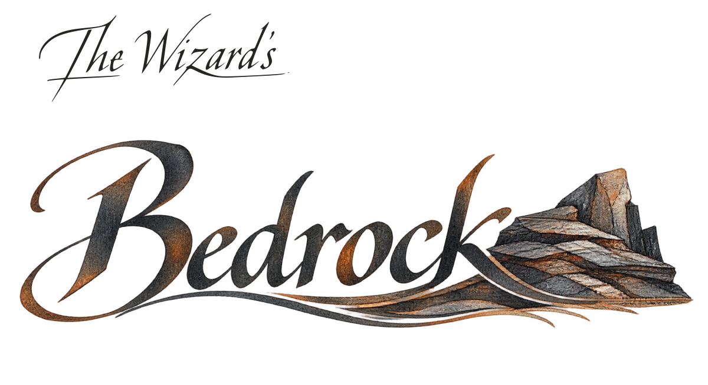

<h1 align="center">
  <picture>
    <source media="(prefers-color-scheme: dark)" srcset="docs/assets/bedrock-logo-dark.png">
    
  </picture>
</h1>

Bedrock is an experimental Rust kernel for x86_64 and UEFI, run in disposable virtual machines.
[Limine](https://github.com/limine-bootloader/limine) enters it in long mode; the kernel then
installs its own descriptor and page tables, turns on the CPU's supervisor protections, schedules
threads, fences PCI DMA behind VT-d, reads an NVMe disk and runs a ring 3 program whose only
authority is a handle table. The workspace version is in `Cargo.toml`.

This repository is the kernel: hardware, memory, scheduling, storage and the native capability
ABI. The operating environment, shell and desktop belong to Realm, which runs on Bedrock; the Wizzy
language and compiler belong to Ink.

## Quick start

Install [rustup](https://rustup.rs) and QEMU 9.2 or later with its EDK2 firmware. The first build
installs the pinned toolchain from `rust-toolchain.toml`.

```
git clone https://github.com/wizards-ecosystem/wizards-bedrock.git
cd wizards-bedrock
cargo fetch --locked
cargo xtask build --release
cargo xtask run
```

On Windows, install rustup with the GNU host (`rustup-init -y --default-host
x86_64-pc-windows-gnu`) and QEMU with `winget install SoftwareFreedomConservancy.QEMU`, then open
a fresh terminal. The runner finds QEMU through `QEMU` (the executable), then `QEMU_DIR` (its
directory), then `C:\Program Files\qemu` on Windows, then `PATH`. It looks for
`edk2-x86_64-code.fd` beside the emulator and under its installation's `share/`;
`QEMU_FIRMWARE_CODE` and `QEMU_FIRMWARE_VARS` override the search.

## Building and running

```
cargo xtask build --release    compile the kernel and check the linked image
cargo xtask image              write target/bedrock.img
cargo xtask run                boot the shipped image in QEMU, serial on stdio
cargo xtask test-boot          boot the self-test kernel and read its verdict
cargo xtask vmware             generate vm/self-test/ (add --shipped for vm/shipped/)
cargo xtask debug              open the debug kernel at kmain in GDB (`GDB`, or gdb on PATH)
cargo xtask help               every task
```

`cargo xtask run -- ARGS` passes `ARGS` through to QEMU.

Never set `RUSTFLAGS`. It replaces the `[target.x86_64-unknown-none]` rustflags in
`.cargo/config.toml`, and the kernel then links without `code-model=kernel` and no error. Pass
lint flags after `--` instead.

`cargo build --workspace` does not work, because the kernel crates build only for
`x86_64-unknown-none`. Bare `cargo check`, `clippy` and `test` cover the host crates through
`default-members`, and three aliases reach the kernel: `cargo kcheck`, `cargo kclippy` and
`cargo kbuild` (a release kernel build).

## The gate

`cargo xtask ci` is the gate, and it must pass on every push to `main`.

| Step | Task | What it requires |
|---:|---|---|
| 1 | `fmt --check` | formatted source |
| 2 | `clippy` | no lint on the host graph or the shipped and self-test kernel graphs |
| 3 | `test` | host tests pass |
| 4 | `supply-chain` | every locked crate has a reviewed license row in `supply-chain/inventory.txt` |
| 5 | `verify-vendor` | every vendored binary matches its `CHECKSUMS` digest |
| 6 | `test-boot --release` | the self-test kernel's verdict passes |
| 7 | `test-boot --debug` | the same with overflow checks on |
| 8 | `boot-check --release` | the shipped image settles with no panic, runs ring 3 and reads an injected key |
| 9 | `degraded-check --release` | a machine without x2APIC and one without an IOMMU each refuse what they must |

Outside the gate, because each needs a tool or a person: `model-check` (TLC over `models/`, needs
Java; run it when a model changes), `vmware` and `qualify-vmware` (a VMware boot, then a check of
its serial transcript), and `debug`. The hosted workflow in `.github/workflows/` runs a subset of
the gate and boots nothing.

## Layout

```
kernel/          the kernel binary; no hand-written unsafe
wost/            the privileged framework, the only crate that writes unsafe
libs/            hardware-free no_std libraries, tested on the host
xtask/           build, image, QEMU and VMware runners, the gate
boot/            limine.conf and the digest-pinned Limine UEFI binary
models/          TLA+ models of the ring protocol
tools/tla/       the digest-pinned TLC jar
supply-chain/    license inventory, third-party notices and license texts
docs/            architecture, conventions, roadmap and decisions
```

| Library | Owns |
|---|---|
| `acpi-tables` | RSDP, XSDT, MADT, DMAR and the platform DMA tables, validated before use |
| `address` | physical addresses below the page-table limit |
| `boot-record` | the versioned one-line records a boot is judged by |
| `eevdf` | virtual-deadline scheduling arithmetic |
| `elf64` | ELF64 headers and loadable segments |
| `entropy` | ChaCha20, BLAKE2s and the seeded random generator state |
| `fat32` | a read-only FAT32 reader over any sector source |
| `frame-space` | the physical frame bitmap |
| `handle-space` | handle encoding and quotas |
| `memory-map` | a bounded firmware memory map that refuses rather than truncates |
| `mmio-range` | checked offsets for repeated MMIO accesses |
| `native-abi` | every value that crosses ring 3: calls, errors, the entry block, ring layout, rights, the time page and fixed addresses |
| `nvme` | NVMe registers, queues and commands |
| `panic-record` | escaped, framed panic records |
| `path-walk` | paths that cannot name an ancestor |
| `pci-config` | configuration-space addresses, BARs, claims and topology |
| `pixel` | colour and framebuffer offset arithmetic |
| `port-space` | I/O port reservations, including wide accesses |
| `ps2-keys` | PS/2 scancode sets 1 and 2 and the US layout |
| `register-bits` | register width conversions |
| `ring-proto` | ring index arithmetic and shared layout |
| `slab-layout` | heap size classes |
| `stack-layout` | guarded stack geometry |
| `timebase` | ticks to nanoseconds by multiply and shift |
| `trap-cause` | exception vector and error-code decoding |
| `vtd` | VT-d registers, tables and invalidation |
| `x86-apic` | local and I/O APIC encodings |
| `x86-cpuid` | CPUID leaves, capability MSRs and the speculation policy |
| `x86-paging` | four-level page-table entries |
| `x86-pit` | 8254 commands and calibration arithmetic |
| `x86-tables` | GDT, IDT, TSS and user-return encodings |

## Read next

- [docs/architecture.md](docs/architecture.md): how the kernel works today.
- [docs/conventions.md](docs/conventions.md): how code and docs are written here.
- [docs/roadmap.md](docs/roadmap.md): the plan, and where the code stands against it.
- [docs/decisions.md](docs/decisions.md): the decisions that still govern the kernel.

Outside contributions arrive through forks and pull requests ([CONTRIBUTING.md](CONTRIBUTING.md)).
Report vulnerabilities privately ([SECURITY.md](SECURITY.md)). Bedrock is MIT licensed
([LICENSE](LICENSE)).
